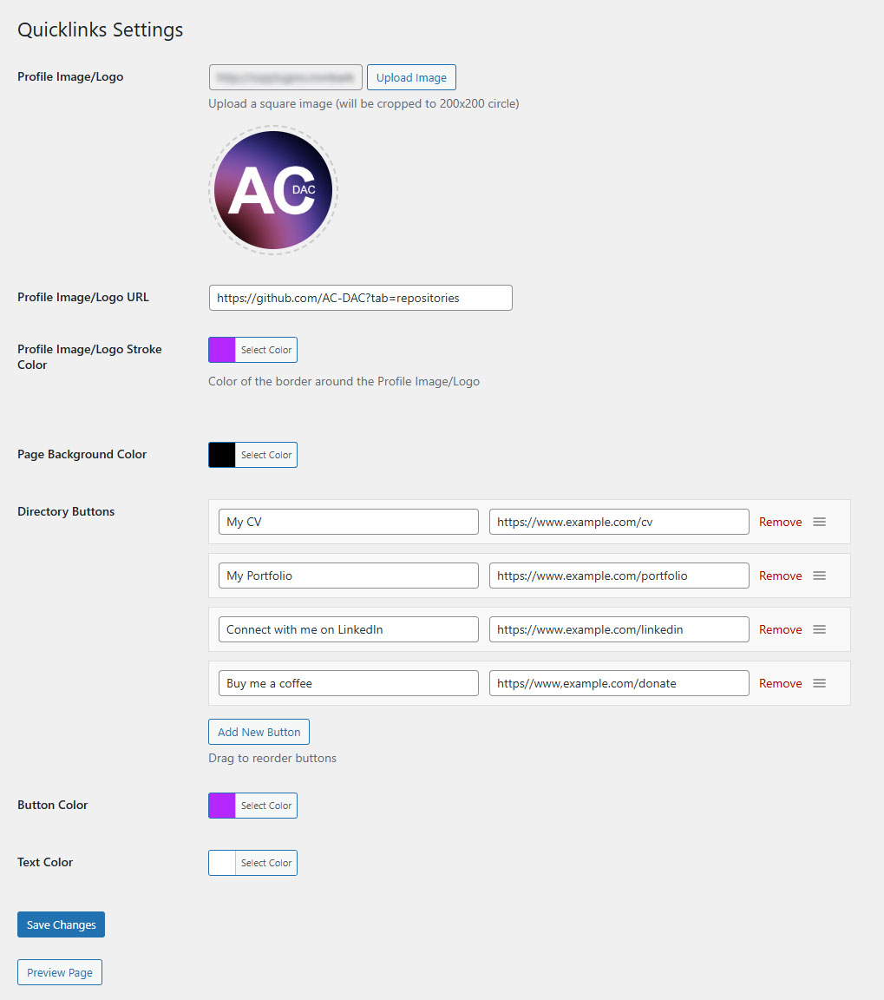
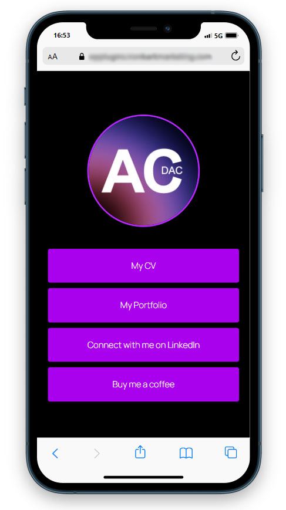
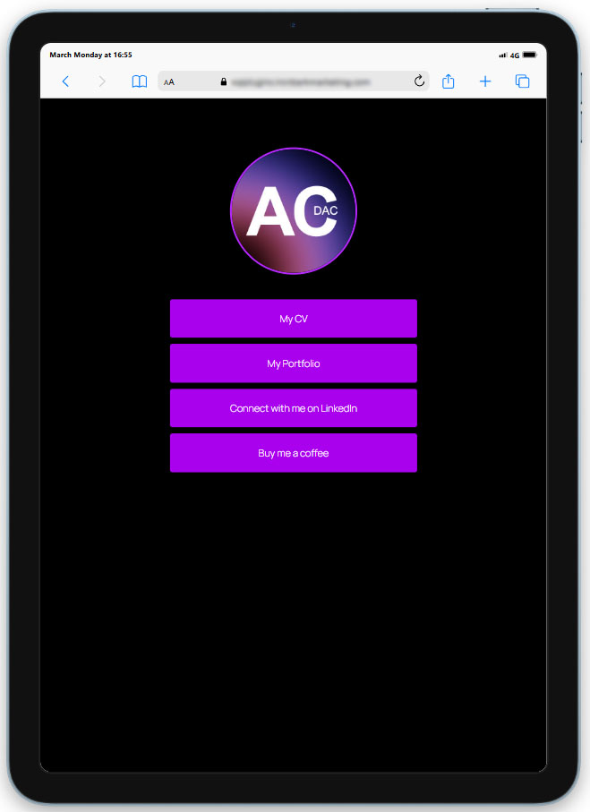

# Quicklinks (Public)

A WordPress plugin that creates a dedicated landing page for sharing shortcut links on your website (e.g. `yourdomain.com/quicklinks/`).

Built by [Alex Chuc](https://github.com/AC-DAC) for [Ironbark Marketing](https://www.ironbarkmarketing.com).

---

## Screenshots

| Settings | Mobile | Tablet |
|----------|--------|--------|
|  |  |  |

---

## Features

- **Customisable** — Add a profile logo/image, background colour, and button colours
- **Drag and drop** — Rearrange links quickly without touching any code
- **SEO-friendly** — Links are served from your own domain

## Requirements

- WordPress 5.6 or higher
- PHP 8.3 or higher
- Pretty permalinks enabled (Settings → Permalinks, anything other than "Plain")
- Tested up to WordPress 7.0.1

## Installation

1. Download the plugin zip
2. In WordPress admin, go to **Plugins → Add New → Upload Plugin**
3. Upload the zip and click **Install Now**
4. Activate the plugin
5. Go to the **Quicklinks** menu item in the WordPress sidebar to configure

The plugin serves the Quicklinks page directly at `/quicklinks/` — no WordPress page is created, so there is nothing to accidentally delete. (Sites upgrading from pre-0.4.0 versions had an auto-created page; it is trashed automatically on upgrade.)

## Usage

- Upload a profile image and set optional link colours via **Quicklinks → Settings**
- Add, remove, and reorder directory buttons using drag and drop
- Visit `yourdomain.com/quicklinks/` to see the live page

## CI/CD Pipeline

Defined in `.github/workflows/quicklinks-release.yml`.

Four-job chain on version tag push (`v*.*.*`):

```
validate → package → release → deploy-update-server
```

- **validate** — runs PHPCS against plugin source enforcing WordPress-Extra ruleset (superset of WordPress Coding Standards), plus `php -l` syntax check
- **package** — zips plugin source into a versioned artifact
- **release** — creates a GitHub Release with the zip attached, version extracted from `README.txt` metadata
- **deploy-update-server** — regenerates `quicklinks.json` manifest from `README.txt` and uploads zip + manifest to the self-hosted update server over FTPS; credentials are a dedicated FTP account jailed to the updates directory

PHPCS configuration in `phpcs.xml`. Dependencies pinned in `composer.json` (PHPCS 3.x + WPCS 3.x).

---

## Tech Stack

| Layer | Technology |
|-------|-----------|
| Language | PHP |
| Standards | WordPress-Extra ruleset (PHPCS 3.x + WPCS 3.x) |
| Linting | PHPCS 3.x |
| CI/CD | GitHub Actions → GitHub Releases → self-hosted update server |
| Packaging | zip artifact |
| Updates | WordPress native update pipeline (`update_plugins_*` filter, WP 5.8+) |

---

## License

Copyright © Ironbark Marketing. All rights reserved. Proprietary — not for redistribution.
